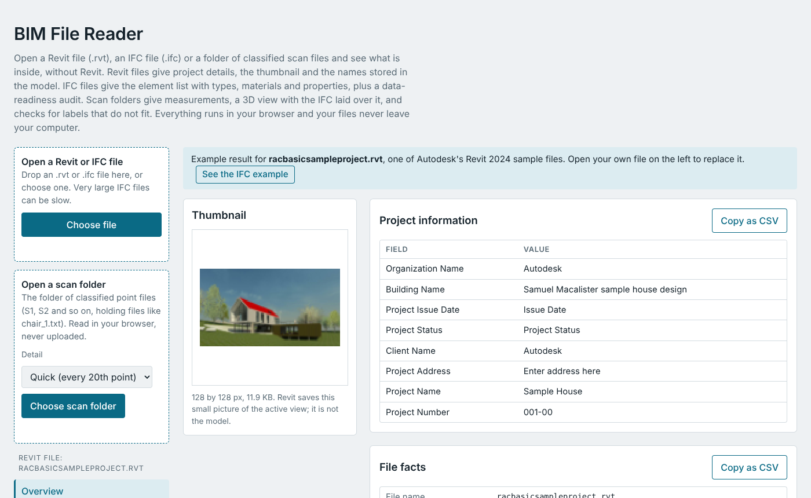
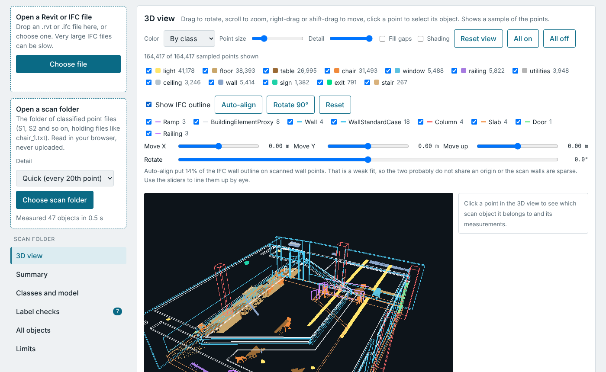

# BimViewer

A single-page browser tool for finding out what is inside BIM files. It reads three kinds of input and shows the result as tables, a thumbnail and a 3D view:

- **Revit files (.rvt)**: project information, the embedded thumbnail, linked files, families and other names found in the file, and a data readiness check.
- **IFC files (.ifc)**: header, units, building hierarchy, a count of elements by class, types, materials, property sets, and the share of elements that have a type, material, classification, fire rating, maker or model, and quantities.
- **Classified point-cloud scans**: a folder of text files, one per object, grouped in slice folders (S1, S2 and so on). It measures every object, lets you view the scan in 3D, click an object to see its measurements, lay the IFC model over the scan, and flags labels that do not fit the shape.

Everything runs in the browser. No file is uploaded anywhere.



## Quick start

1. Open `dist/index.html` in Chrome, Edge or Firefox (double-click it, or serve the folder from any static web host).
2. The page opens with built-in examples (a Revit sample and an IFC sample), so you can look around before loading anything.
3. Load your own file with the buttons at the top.

The page loads one small library (pako 1.0.11) from cdnjs, so it needs an internet connection the first time.

You do not need Node, Python or Revit to use it. Those are only needed if you change the code.

## Using it

### Revit files

Choose an .rvt file. The page shows the file facts, the thumbnail Revit saved inside it, the project information fields, external links, and the text found in the file grouped by kind (families, levels, parameters and similar). It also scores how ready the file is for downstream work such as a submittal register.

Revit keeps its element data in a format that only Revit can fully decode. This tool reads the container and the parts that can be read safely, so the counts it shows are *mentions* of a name in the file, not a count of placed elements. For true element counts, export an IFC from Revit and load that instead.

### IFC files

Choose an .ifc file. You get the file header, the exporting application, units, the project and building hierarchy, element counts by class, and a searchable list of elements. Click a row to see its type, level, materials and property sets. The readiness table shows, per class, how many elements carry the data a submittal register needs.

Each table has a Copy as CSV button, because downloads are blocked inside some viewers.

### Scan folders

Choose the folder that holds the slice folders. The expected layout is:

```
L1_C106_Slices/
  S1/
    chair_1.txt
    wall_5.txt
    window_2.txt
  S2/
    chair_23.txt
    ...
```

The class comes from the file name (`chair`, `wall`, `window`) and the slice from the folder name. Each line in a file is `x y z r g b intensity`, and distances are read as meters.

Pick a detail level before loading:

- **Quick** measures every 20th point and still counts all of them. It reads at roughly 500 MB/s in tests.
- **Exact** measures every point, at roughly 170 MB/s.

Files that do not match the pattern, such as a single huge combined point file, are skipped and counted.

You get:

- A summary of objects, points, and the room (floor height, ceiling height, overall extent).
- A table of classes with typical sizes in meters and feet.
- A model versus scan comparison against the IFC currently loaded in the page.
- A table of every object. Click a row for its full measurements.

### 3D view

- Drag to rotate, scroll to zoom, right-drag or shift-drag to move, pinch on a touch screen.
- Color by class, true color, or height.
- Turn classes on and off with the checkboxes.
- **Click a point** to select its object. The object's points turn white, a yellow box marks its trimmed size, and a panel shows class, slice, point count, size in meters and feet, height range, center, average color and file.
- The view shows a thinned sample of the points so that large scans stay smooth. The **Detail** slider shows 5% to 100% of that sample.
- **Fill gaps** draws each point as a disc that grows as you zoom in, so surfaces look more solid. **Shading** gives each disc a lit, rounded look. Both change only how points are drawn, not the data, and measurements always use the real points.



### IFC overlay

Tick **Show IFC outline** above the 3D view to draw the IFC model as colored wireframe on top of the scan. It uses whichever IFC is loaded in the page, so load your IFC first, then choose the scan folder.

The model and the scan use different coordinate systems (the IFC is in project coordinates, the scan is local), so they need aligning:

- **Auto-align** centers the model on the scan, tries four rotations and small shifts, and scores each by how much of the IFC wall outline lands on scanned wall points. The score is shown under the sliders.
- **Move X, Move Y, Move up and Rotate** sliders nudge the result by hand.
- **Rotate 90°** and **Reset** are there for quick fixes.
- Each IFC class can be turned on and off.

Treat a low alignment score as a sign to adjust by eye. Auto-align has only been tried on a four-slice subset of the sample scan, not on a full one.

### Label sanity checks

The scan card flags segments whose label does not match their shape, using size and height above the floor under each object, so a room with a pit or raised platform is handled. Examples: a window that starts on the floor and is chair-sized, a chair taller than 1.5 m (furniture is not checked for height off the floor), a light near the floor, or a segment more than three times the size of its peers. Each flag is rated Likely wrong, Check or Minor, with a plain-language reason and a **Show in 3D** button. The object table has a QA column and a Flagged only filter.

These are rules of thumb. A flag means the label and the shape disagree, not which one is wrong. The thresholds live in the `RULES` table in `src/scan.js` and are easy to adjust.

## Repository layout

```
dist/index.html      The built page, one self-contained file
src/
  template.html      Page markup, styles and UI logic
  rvt.js             Revit container reader (OLE streams, thumbnail, strings)
  ifc.js             IFC (STEP) parser, audit and wireframe geometry
  scan.js            Scan streaming reader, measurements, QA rules
  viewer.js          Minimal WebGL point and line renderer with picking
data/                Example results embedded in the page
tools/               Scripts that regenerate the embedded examples
tests/               Node and browser tests
research/            Python scripts used to explore the Revit file format
docs/img/            Screenshots
build.py             Assembles dist/index.html
```

## Development

Requirements: Node 18 or newer and Python 3. The built page does not need either.

```
npm install          # pako and playwright, only needed for tests and tools
python3 build.py     # rebuilds dist/index.html from src/ and data/
```

Edit the files in `src/`, run `python3 build.py`, and reload `dist/index.html`. Do not edit `dist/index.html` by hand, since the build overwrites it.

### Sample files for tests

The tests and the example generators read your own sample files, which are not stored in this repository. Put them in a folder named `samples/` at the repository root, or point `BIM_SAMPLES` at another folder:

```
samples/
  Revit Sample projects/racbasicsampleproject.rvt     (and other .rvt files)
  BIM sample/L1_C106_IFC.ifc
  BIM sample/L1_C106_Slices/S1/chair_1.txt            (and the other slices)
```

```
export BIM_SAMPLES=/path/to/samples
node tests/tifc.js          # IFC audit on the sample IFC
node tests/tqa.js           # scan measurements and QA flags
node tests/pw8.js           # browser test: load a scan folder, QA list, Show in 3D, phone width
node tests/pw5.js           # browser test: click to select and the IFC overlay
node tools/mksample.js      # regenerate data/sample.json from a Revit file
node tools/mkifc.js         # regenerate data/sample_ifc.json from the IFC
```

The browser tests use Playwright's Chromium with software WebGL, so they run on a machine without a GPU.

## Known limits

- Revit element data cannot be decoded without Revit, so Revit results show mentions, not element counts.
- The IFC overlay draws extruded shapes, faceted breps and mapped items. Other geometry types are skipped, and openings are not subtracted from walls.
- Scan labels come from whoever classified the scan and can be wrong. The sanity checks help find the obvious cases.
- Very large single files (for example a 2 GB combined point file) are not read. Use the per-object slice files.
- Alignment of the IFC to a full scan is unverified. Expect to adjust it by hand.
