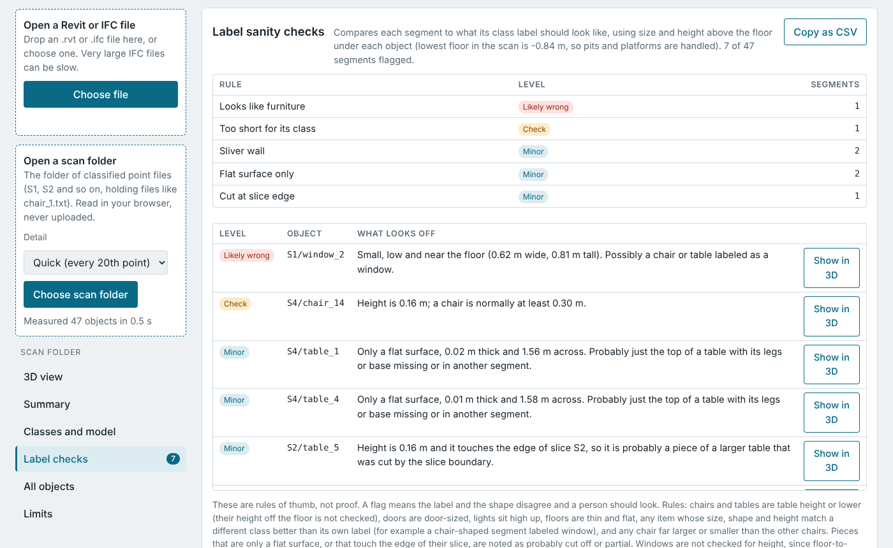

# BimViewer

A single-page browser tool for finding out what is inside BIM files. It reads three kinds of input and shows the result as tables, a thumbnail and a 3D view:

- **Revit files (.rvt)**: project information, the embedded thumbnail, linked files, families and other names found in the file, and a data readiness check.
- **IFC files (.ifc)**: header, units, building hierarchy, a count of elements by class, types, materials, property sets, and the share of elements that have a type, material, classification, fire rating, maker or model, and quantities.
- **Classified point-cloud scans**: a folder of text files, one per object, grouped in slice folders (S1, S2 and so on). It measures every object, lets you view the scan in 3D, click an object to see its measurements, lay the IFC model over the scan, and flags labels that do not fit the shape.

Everything runs in the browser. No file is uploaded anywhere.


## Ways to run it

| | In a browser | In Claude |
|---|---|---|
| What you open | `dist/index.html` | The same page, published as a Claude artifact |
| Revit, IFC and scan viewing | Yes | Yes |
| Ask Claude chat | No, the screen says it cannot reach Claude | Yes, using your own Claude account |
| Setup | None | Ask Claude to publish the page (steps below) |

### In a browser

1. Open `dist/index.html` in Chrome, Edge or Firefox (double-click it, or serve the folder from any static web host such as GitHub Pages).
2. The page opens with built-in examples (a Revit sample and an IFC sample), so you can look around before loading anything.
3. Load your own file with the buttons under the title.

The page loads one small library (pako 1.0.11) from cdnjs, so it needs an internet connection the first time. You do not need Node, Python or Revit to use it. Those are only needed if you change the code.

### In Claude (to use the chat)

The chat works only when the page runs inside Claude, because it asks Claude through the viewer's own account. No API key is stored anywhere in this repository, and nobody else's account can be used.

1. Start a chat in Claude with the Artifact feature available (Claude on the web or the desktop app, or Claude Code).
2. Attach `dist/claude-artifact.html`, or paste its contents.
3. Ask: "Publish this file as an artifact exactly as it is, with the sample capability turned on so the chat works."
4. Open the artifact, go to the Ask Claude screen, ask a question, and approve the one-time permission prompt.

The artifact is private to you until you share it. Anyone you share it with uses their own Claude usage when they ask a question. These steps are written from how the page was built and published here, and have not been tried by anyone else. If a step does not work, open an issue.

## Claude skill: analyze a file

The repository includes a skill, `skills/analyze-bim-file/SKILL.md`, that does the whole job from a chat. You attach a Revit (.rvt) or IFC (.ifc) file, or say which file to use, and Claude reads it, builds a copy of the viewer that opens already showing that file's results, and publishes it as a Claude artifact with the Ask Claude chat turned on. If you already have an analysis page it asks whether to replace it or make a new one.

### Set it up

1. Get the skill into your Claude account. Start a chat in Claude, attach `skills/analyze-bim-file/SKILL.md` and ask: "Create a skill from this file, keeping the text exactly as it is." Claude shows a card where you review and save it. If your Claude app has a place to upload skills, you can use that instead.
2. Use a Claude app where Artifacts and the code environment are available, since the skill publishes a page and runs the repository's tools.
3. The skill downloads this repository when it runs, so keep the repository public, or give your Claude account access to it if it is private. It needs only Node and Python 3, which the code environment has. Nothing to install on your own computer.

### Use it

Attach a file and say "analyze this", or just say "analyze a BIM file" and Claude asks for one. You will see an approval prompt for publishing the page, and on your first question in the page, a permission prompt for using your Claude account. The reply gives the link card, a few findings from the file, and a reminder that the page contains the file's facts, so treat the link like the file when sharing.

Limits: Revit and IFC files only for now. Scan folders are not supported by the skill yet, because they are too large to send; open them in the viewer page directly. Revit files give project details and names but not element counts. The pieces have been tested separately, but the skill has not been run end to end on anyone else's account. If a step does not work, open an issue.

## Snapshots (preloaded pages)

A snapshot is a page that opens already showing one file's results, with Ask Claude ready, so it can be shared as a report. It is the basis of the analyze-a-file skill.

```
node tools/snapshot.js path/to/model.ifc snapshot.json      # or an .rvt file; needs only Node, no npm install
python3 build.py --snapshot snapshot.json --fragment page.html
```

`page.html` is the viewer with that file's results built in. Publish it as a Claude artifact with the `sample` capability to get the chat. Scan folders are not supported by the snapshot command yet. A snapshot contains the file's facts, such as its name, size, project information and (for Revit) the names found inside, so treat the page like the file when you share it.

## Using it

The page opens with two buttons under the title: one for a Revit or IFC file, one for a scan folder. You can also drop a file anywhere on the page. The intro text stays at the top. A line under it says what is open: the kind (Revit file, IFC file or scan folder), its name, and its size, plus the object count and measuring time for a scan. The two buttons stay in place to open a different file or folder. The page below has a menu on the left and one screen at a time on the right. The menu lists the screens for whatever is loaded, and the page remembers the last screen you used for each kind of file. On a phone the menu sits above the screen and the list of screens scrolls sideways.

| File type | Screens |
|---|---|
| Revit | Overview, Readiness, Inside the file, Names and units, Text and links, Ask Claude, Limits |
| IFC | Overview, Model contents, Readiness, Types and materials, Property sets, Elements, Ask Claude, Limits |
| Scan folder | 3D view, Summary, Classes and model, Sanity checks (with a count of flags), All objects, Ask Claude, Limits |

### Revit files

Choose an .rvt file. The page shows the file facts, the thumbnail Revit saved inside it, the project information fields, external links, and the text found in the file grouped by kind (families, levels, parameters and similar). It also scores how ready the file is for downstream work such as a submittal register.

Revit keeps its element data in a format that only Revit can fully decode. This tool reads the container and the parts that can be read safely, so the counts it shows are *mentions* of a name in the file, not a count of placed elements. For true element counts, export an IFC from Revit and load that instead.

### IFC files

Choose an .ifc file. You get the file header, the exporting application, units, the project and building hierarchy, element counts by class, and a searchable list of elements. Click a row to see its type, level, materials and property sets. The readiness table shows, per class, how many elements carry the data a submittal register needs.

Each table has a Copy as CSV button, because downloads are blocked inside some viewers.

### Scan folders

Choose the folder that holds the slice folders. The expected layout is:

```
L1_C106_Slices/
  S1/
    chair_1.txt
    wall_5.txt
    window_2.txt
  S2/
    chair_23.txt
    ...
```

The class comes from the file name (`chair`, `wall`, `window`) and the slice from the folder name. Each line in a file is `x y z r g b intensity`, and distances are read as meters.

Pick a detail level before loading:

- **Quick** measures every 20th point and still counts all of them. It reads at roughly 500 MB/s in tests.
- **Exact** measures every point, at roughly 170 MB/s.

Files that do not match the pattern, such as a single huge combined point file, are skipped and counted.

You get:

- A summary of objects, points, and the room (floor height, ceiling height, overall extent).
- A table of classes with typical sizes in meters and feet.
- A model versus scan comparison against the IFC currently loaded in the page.
- A table of every object. Click a row for its full measurements.

### 3D view

- Drag to rotate, scroll to zoom, right-drag or shift-drag to move, pinch on a touch screen.
- Color by class, true color, or height.
- Turn classes on and off with the checkboxes.
- **Click a point** to select its object. The object's points turn white, a yellow box marks its trimmed size, and a panel shows class, slice, point count, size in meters and feet, height range, center, average color and file.
- The view shows a thinned sample of the points so that large scans stay smooth. The **Detail** slider shows 5% to 100% of that sample.
- **Fill gaps** draws each point as a disc that grows as you zoom in, so surfaces look more solid. **Shading** gives each disc a lit, rounded look. Both change only how points are drawn, not the data, and measurements always use the real points.


### Ask Claude (chat)

The **Ask Claude** screen lets you ask questions about whatever is loaded, such as "which classes are missing material data?" or "which chairs look wrong?". Claude sees a short text summary of the file (file facts, class counts, readiness percentages, the Sanity check flags and the selected object) and can run two searches on the real data in the page, `find_elements` for IFC and `find_objects` for scans, so counts and lists come from the file and not from a guess. Open **What gets sent to Claude** on that screen to see the exact summary. No point data, geometry or raw file contents are sent. The **Chat enabled** box turns it off.

Chat only works when the page runs as a Claude artifact (see Ways to run it above). In a standalone copy of `dist/index.html` the screen says it cannot reach Claude. A typical question sends roughly 1,000 to 4,000 tokens.

### IFC overlay

Tick **Show IFC outline** above the 3D view to draw the IFC model as colored wireframe on top of the scan. It uses whichever IFC is loaded in the page, so load your IFC first, then choose the scan folder.

The model and the scan use different coordinate systems (the IFC is in project coordinates, the scan is local), so they need aligning:

- **Auto-align** centers the model on the scan, tries four rotations and small shifts, and scores each by how much of the IFC wall outline lands on scanned wall points. The score is shown under the sliders.
- **Move X, Move Y, Move up and Rotate** sliders nudge the result by hand.
- **Rotate 90°** and **Reset** are there for quick fixes.
- Each IFC class can be turned on and off.

Treat a low alignment score as a sign to adjust by eye. Auto-align has only been tried on a four-slice subset of the sample scan, not on a full one.

### Sanity checks

The Sanity checks screen flags segments whose label does not match their shape, using size and height above the floor under each object, so a room with a pit or raised platform is handled. Examples: a chair-sized segment labeled window, a chair taller than 1.5 m, a light near the floor, a segment whose size, shape and height fit a different class much better than its own label (it needs at least 3 other segments of its own class and 4 of the other class to judge), or a chair far larger or smaller than the other chairs. Pieces that are only a flat surface (such as a tabletop without legs) or that touch the edge of their slice are noted as probably partial. Windows are not checked for height because floor-to-ceiling glass is normal, and walls, floors, lights and tables are not compared with their peers because their sizes vary. Each flag is rated Likely wrong, Check or Minor, with a plain-language reason and a **Show in 3D** button. The object table has a QA column and a Flagged only filter.



These are rules of thumb. A flag means the label and the shape disagree, not which one is wrong. The thresholds live in the `RULES` table in `src/scan.js` and are easy to adjust.

## Repository layout

```
dist/index.html      The built page, one self-contained file
dist/claude-artifact.html  The same page without the html wrapper, for publishing as a Claude artifact
src/
  template.html      Page markup, styles and UI logic
  rvt.js             Revit container reader (OLE streams, thumbnail, strings)
  ifc.js             IFC (STEP) parser, audit and wireframe geometry
  scan.js            Scan streaming reader, measurements, QA rules
  viewer.js          Minimal WebGL point and line renderer with picking
data/                Example results embedded in the page
skills/              The analyze-bim-file Claude skill (SKILL.md)
vendor/              Bundled pako 1.0.11 (MIT) used by tools/snapshot.js
tools/               Scripts that regenerate the embedded examples, and snapshot.js
tests/               Node and browser tests
research/            Python scripts used to explore the Revit file format
docs/img/            Screenshots
build.py             Assembles dist/index.html (add --fragment OUT for a copy without the html wrapper)
```

## Development

Requirements: Node 18 or newer and Python 3. The built page does not need either.

```
npm install          # pako and playwright, only needed for tests and the other tools
python3 build.py     # rebuilds dist/index.html from src/ and data/
```

Edit the files in `src/`, run `python3 build.py`, and reload `dist/index.html`. Do not edit `dist/index.html` by hand, since the build overwrites it.

### Sample files for tests

The tests and the example generators read your own sample files, which are not stored in this repository. Put them in a folder named `samples/` at the repository root, or point `BIM_SAMPLES` at another folder:

```
samples/
  Revit Sample projects/racbasicsampleproject.rvt     (and other .rvt files)
  BIM sample/L1_C106_IFC.ifc
  BIM sample/L1_C106_Slices/S1/chair_1.txt            (and the other slices)
```

```
export BIM_SAMPLES=/path/to/samples
node tests/tifc.js          # IFC audit on the sample IFC
node tests/tqa.js           # scan measurements and QA flags
node tests/pw_layout.js     # browser test: left menu and screens for Revit, IFC and scan, desktop and phone
node tests/pw8.js           # browser test: load a scan folder, QA list, Show in 3D, phone width
node tests/pw_chat.js       # browser test: Ask Claude screen with a fake Claude
node tests/pw5.js           # browser test: click to select and the IFC overlay
node tools/mksample.js      # regenerate data/sample.json from a Revit file
node tools/mkifc.js         # regenerate data/sample_ifc.json from the IFC
```

The browser tests use Playwright's Chromium with software WebGL, so they run on a machine without a GPU.

## Known limits

- Revit element data cannot be decoded without Revit, so Revit results show mentions, not element counts.
- The IFC overlay draws extruded shapes, faceted breps and mapped items. Other geometry types are skipped, and openings are not subtracted from walls.
- Scan labels come from whoever classified the scan and can be wrong. The sanity checks help find the obvious cases.
- Very large single files (for example a 2 GB combined point file) are not read. Use the per-object slice files.
- Alignment of the IFC to a full scan is unverified. Expect to adjust it by hand.
